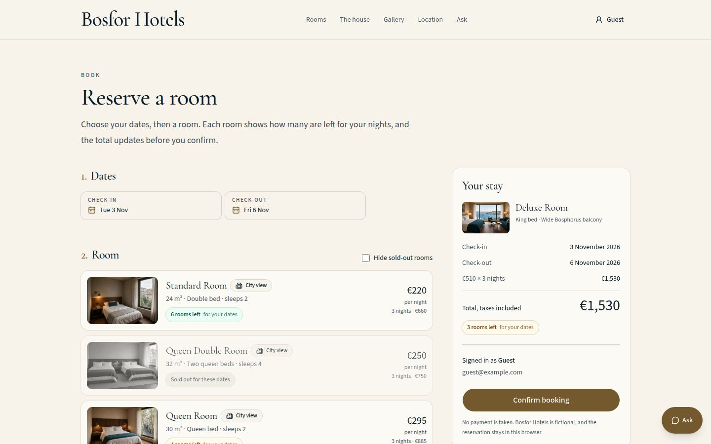

# Bosfor Hotels

A portfolio demo of a hotel booking site: a fictional house hotel on a hillside street in Bebek, Istanbul, with live-looking room availability, a date-range booking flow, demo accounts and an on-site concierge. It is a static Next.js export with no backend. Everything the visitor does is stored in their own browser.

**Live site:** [https://rdmrcn.github.io/HotelManagment-WebAPI/](https://rdmrcn.github.io/HotelManagment-WebAPI/)
**Author:** [Reha Demircan](https://reha-demircan-portfolio.vercel.app/) · [Source on GitHub](https://github.com/rdmrcn/HotelManagment-WebAPI)

> Demo project, fictional brand. Bosfor Hotels is not a real hotel, nothing is for sale, checkout is a demo with no real charge, and no data leaves the browser. Reviews are sample text.

## Screenshots

| | Desktop | Mobile |
| --- | --- | --- |
| Home | [home-desktop](docs/screenshots/home-desktop.jpg) | [home-mobile](docs/screenshots/home-mobile.jpg) |
| Rooms with dates | [rooms-desktop](docs/screenshots/rooms-desktop.jpg) | [rooms-mobile](docs/screenshots/rooms-mobile.jpg) |
| Room, Bosphorus side | [room-deluxe-desktop](docs/screenshots/room-deluxe-desktop.jpg) | [room-deluxe-mobile](docs/screenshots/room-deluxe-mobile.jpg) |
| Room, city side | [room-queen-desktop](docs/screenshots/room-queen-desktop.jpg) | [room-queen-mobile](docs/screenshots/room-queen-mobile.jpg) |
| Booking | [book-desktop](docs/screenshots/book-desktop.jpg) | [book-mobile](docs/screenshots/book-mobile.jpg) |
| Sign in | [sign-in-desktop](docs/screenshots/sign-in-desktop.jpg) | [sign-in-mobile](docs/screenshots/sign-in-mobile.jpg) |
| Account | [account-desktop](docs/screenshots/account-desktop.jpg) | [account-mobile](docs/screenshots/account-mobile.jpg) |

<p>
  
  
</p>

## Features

**Accounts (demo)**
- Sign in or register with any email and any password of six or more characters.
- An unknown email creates the account and signs you in. A known email needs the same password, otherwise you get a clear error.
- Email format and password length are validated. The session survives reloads, sign-out works, and `/account` shows the guest and their stays.
- Passwords are salted and hashed with SHA-256 through `crypto.subtle` (with a pure-JS fallback for plain-HTTP origins). The form carries a "demo site, do not use a real password" notice.

**Availability**
- Seeded, deterministic, but believable availability for the next 60 days for every room type. Weekends and Turkish public holidays are busier, cheaper rooms have more units, and some nights sell out.
- Units per type: Standard 12, Queen 10, King 8, Queen Double 6, King Double 6, Deluxe 5, Suite 3, Bosfor Suite 2.
- "N rooms left" appears on room cards, room pages and the booking flow, with "Only 1 left" / "Only 2 left" urgency.
- The date picker and the rooms list react to sold-out nights. Booking checks every night of the stay, and the visitor's own saved bookings reduce availability. Dates past the 60-day window get a friendly message.

**Demo checkout**
- Booking ends in a card form (name, number, expiry, CVC) with Luhn and expiry validation and the notice "Demo checkout. No real charge. Use 4242 4242 4242 4242."
- `4242 4242 4242 4242` with any future expiry and any 3-digit CVC succeeds. `4000 0000 0000 0002` is declined with a clear error. Any other number that passes Luhn gets "Only the demo card is accepted". Failed payments create no booking and leave availability untouched.
- There is no server and no Stripe key. `src/lib/payment.ts` only recognises Stripe's published test numbers. The full card number, expiry and CVC are never stored. The booking keeps the card brand and the last four digits only.
- After payment, `/confirmation/?ref=BOS-XXXX` shows the reference, room, dates, guests, nightly rate, total, last four digits and a link to `/receipt/?ref=BOS-XXXX`, a reservation voucher that prints cleanly with `window.print()`. Both pages only open for the account that paid, in the browser that holds the booking.
- Sign-in rules are unchanged: you sign in first, then pay.

**Booking and browsing**
- Sticky header with a Book now call to action, hero search bar, accessible date-range picker (keyboard navigation, bottom sheet on mobile), filter by side, sort by price, size or rooms left, a "hide sold-out rooms" toggle.
- Sticky stay summary on desktop and a bottom bar on mobile, guest count, cancel a stay and open its receipt from the account page.
- Gallery with a lightbox, amenities, sample reviews, location section with a click-to-load OpenStreetMap, footer with contact and policies.
- A sitewide concierge ("Ask") that answers questions about rooms, prices, views, dates, availability and the account flow. It matches the question to a short answer in the browser.

**The hillside story**
- The house is built into a steep street between Besiktas and Bebek. Deluxe, Suite and Bosfor Suite face the Bosphorus. Standard, Queen, King, Queen Double and King Double face the street and the rooftops. Rooms carry "Bosphorus view" or "City view" badges, and the rooms page has a "which side" explainer with a hillside diagram.

## Tech stack

- Next.js 16 (App Router, `output: "export"`), React 19, TypeScript
- Tailwind CSS 4, shadcn/ui with Base UI primitives, lucide-react icons
- Vitest for unit tests, ESLint with the React Compiler rules, `tsx` for the concierge script
- GitHub Actions deploys the static `out/` folder to GitHub Pages

## Performance

Lighthouse on a production build served with HTTP/2 and compression (mobile and desktop presets): Performance 93 to 99 on mobile and 100 on desktop, with Accessibility, Best Practices and SEO at 100 on `/`, `/rooms/`, a room page, `/book/`, `/sign-in/`, `/register/`, `/account/` and `/ask/`.

Static export has no image optimizer, so photos ship as pre-sized WebP variants (`public/images/w/`) selected by a custom `next/image` loader (`src/lib/image-loader.ts`). Regenerate them after changing a photo in `public/images/`:

```bash
node scripts/make-image-variants.mjs
```

## Architecture notes

- **No server.** Guests, bookings and the session live in `localStorage` under `bosfor-hotels.*`. `src/lib/storage.ts` is the only module that touches it, and the auth provider (`src/components/auth-provider.tsx`) exposes it through `useSyncExternalStore`, with a "loading" server snapshot so static HTML never contains per-visitor state and hydration stays consistent.
- **Availability** (`src/lib/availability.ts`) hashes `(room, date)` with FNV-1a into a mulberry32 PRNG, so a given night always has the same number of units for everyone. Demand is a base level plus weekday, holiday, season and room-popularity terms plus noise. The visitor's own bookings are subtracted on top.
- **"Today" is never baked into the HTML.** `useToday()` returns an empty string on the server, so the static pages do not freeze the build date, and date-dependent UI appears after hydration.
- **Pages that need the query string** read it through `useUrlSearch()` (rooms) so the room list is real HTML, or sit behind `Suspense` with a sized skeleton (book, sign-in, register) so the layout does not jump.
- **Routing** keeps the GitHub Pages base path `/HotelManagment-WebAPI` for local and production alike (`next.config.ts`, `src/lib/asset.ts`).
- **Metadata:** Open Graph and Twitter tags, a web manifest, `robots.txt`, a sitemap, an SVG favicon and an Apple touch icon.

## Known limitations

- Demo only. There is no real backend, payment processor or email. The card form is a simulation, so no card is ever charged or sent anywhere. Clearing site data removes accounts and bookings.
- Accounts and bookings are per browser. Nothing syncs between devices, and the same stay can be booked in two browsers.
- Hashing in the browser protects nothing against someone with access to that browser. It is there to avoid storing plain text, not as real authentication.
- Availability is simulated, not read from a property system, and is limited to 60 days ahead.
- Photos are illustrative images of a fictional place. Reviews and contact details are placeholders.
- The map loads from OpenStreetMap only after a click.

## Run locally

Requires Node.js 22 or newer.

```bash
npm install
npm run dev
```

Open [http://127.0.0.1:43123/HotelManagment-WebAPI/](http://127.0.0.1:43123/HotelManagment-WebAPI/). On Windows, `start-bosfor-hotels.bat` does the same in one click.

### Scripts

| Script | What it does |
| --- | --- |
| `npm run dev` | Development server on port 43123 |
| `npm run build` | Static export to `out/` |
| `npm run lint` | ESLint |
| `npm run typecheck` | `next typegen` then `tsc --noEmit` |
| `npm test` | Vitest unit tests (auth, password hashing, availability, payment and checkout, concierge) and the scripted concierge check |
| `npm run check` | Lint, typecheck and tests |

The Pages workflow (`.github/workflows/pages.yml`) runs lint, typecheck and tests before it builds and deploys, and also runs them on pull requests.

## Rooms

Rates are per room, per night, in euros, taxes included.

| Room | Side | View | Units | Nightly |
| --- | --- | --- | --- | --- |
| Standard Room | City | Rooftops | 12 | €220 |
| Queen Double Room | City | Side street | 6 | €250 |
| Queen Room | City | Across the street | 10 | €295 |
| King Double Room | City | Rooftops | 6 | €340 |
| King Room | City | City buildings | 8 | €385 |
| Deluxe Room | Bosphorus | Wide balcony | 5 | €510 |
| Suite Room | Bosphorus | Strait, two rooms | 3 | €780 |
| Bosfor Suite Room | Bosphorus | Private terrace | 2 | €1,250 |
